# Counterstrike Agents Fleet: Architecture

This document describes the system at three levels, following the C4 model:

1. **System context**: who uses the system and which external systems it talks to.
2. **Containers**: the separately running parts of the system.
3. **Components**: the main modules inside the worker and the API.

A sequence diagram follows one scheduled run from feed poll to owner alert, and the last section compares the manual process with the automated workflow.

**Legend.** Solid arrows are active in the default configuration. Dashed arrows are implemented but **off by default** and enabled only by explicit settings and approvals (see [DELIVERY.md](DELIVERY.md) and `.env.example`). The diagrams reflect the code on 1 November 2026.

**Images and sources.** Each diagram is shown as a PNG from [diagrams/](diagrams/), so it displays in any Markdown viewer. The Mermaid source sits under it in a collapsed "Mermaid source" section. After editing a source, regenerate its image, for example `npx -p @mermaid-js/mermaid-cli@11.4.2 mmdc -i diagram.mmd -o docs/diagrams/<name>.png -w 1800 -s 2 -b white`.

## 1. System context

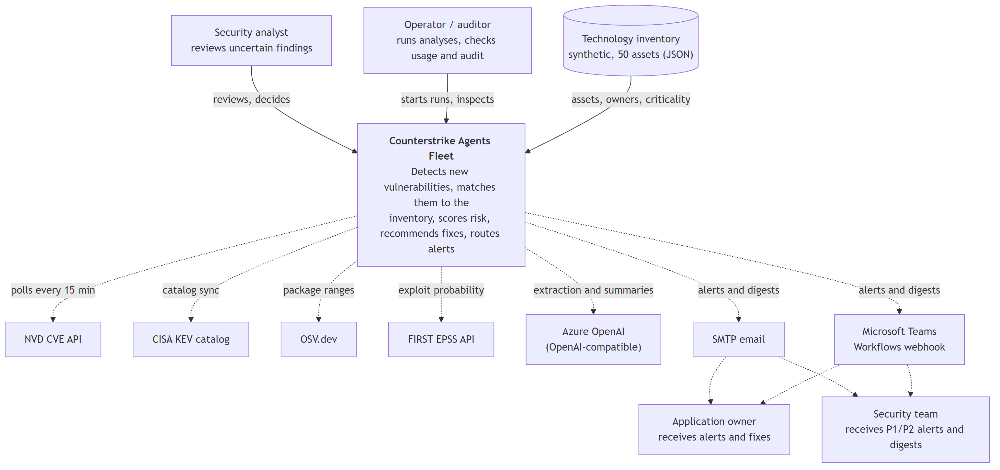

Mermaid source

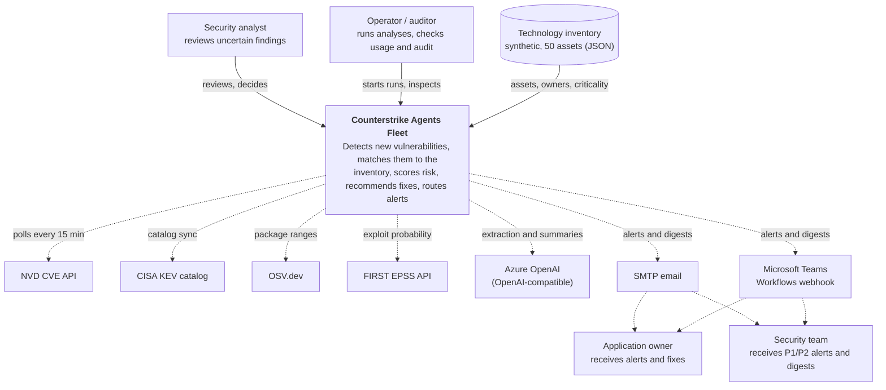

| External system | Used for | Default state |
|---|---|---|
| NVD | New and modified CVEs, CVSS, CPE version ranges, references | Off (`PUBLIC_FEEDS_ENABLED`); local fixtures used instead |
| CISA KEV | Known-exploited flag | Off; fixture `kev.json` used instead |
| OSV.dev | Package version ranges and descriptions | Off, with the public feeds |
| FIRST EPSS | Exploit probability (enrichment) | Off (`EPSS_ENABLED`, `EPSS_APPROVED`) |
| Azure OpenAI | Free-text extraction and impact summary wording | Off; offline `FakeLLM` used instead |
| SMTP / Teams | Owner and security alerts, daily digest | Off (`OUTBOX_DELIVERY_ENABLED`) |

## 2. Containers

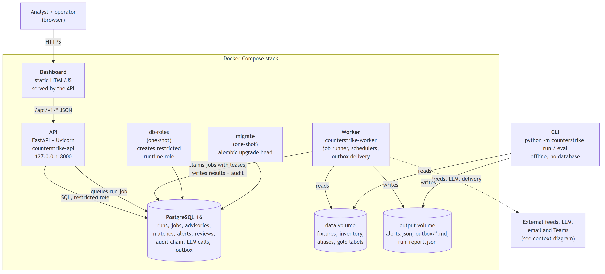

Mermaid source

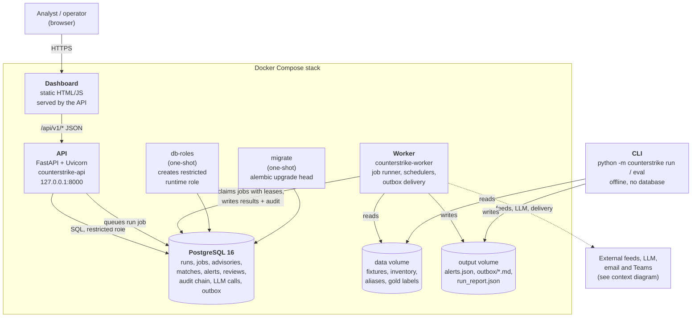

| Container | Responsibility | Code |
|---|---|---|
| Dashboard | Overview, alerts, review queue, inventory, runs, sources, LLM usage, audit | `frontend/` |
| API | Versioned REST API, role checks, request audit, manual run queueing, health and metrics | `api.py`, `server.py` |
| Worker | Claims queued jobs, runs the agent pipeline, persists results, delivers outbox messages; hosts the source-poll and daily-digest schedulers | `worker.py`, `source_scheduler.py`, `digest_scheduler.py`, `delivery.py` |
| PostgreSQL | System of record; audit events are hash-chained and cannot be updated or deleted by the runtime role | `db_models.py`, `migrations/` |
| db-roles, migrate | One-shot setup: least-privilege runtime role, then schema migrations as the owner | `db_roles.py`, `alembic.ini` |
| CLI | Offline run and evaluation gate used by CI; same pipeline, file output only | `cli.py` |

`frontend/server.js` is an older standalone preview server that reads the CLI's `out/` files. The API now serves the dashboard directly.

## 3. Components

### 3a. Agent pipeline (inside the worker and the CLI)

The pipeline is a fixed LangGraph state graph. Routing is code; the LLM is called only inside **Extract** (free-text bulletins) and **Remediate** (summary wording), and it can never set a match, score, priority, owner or fix.

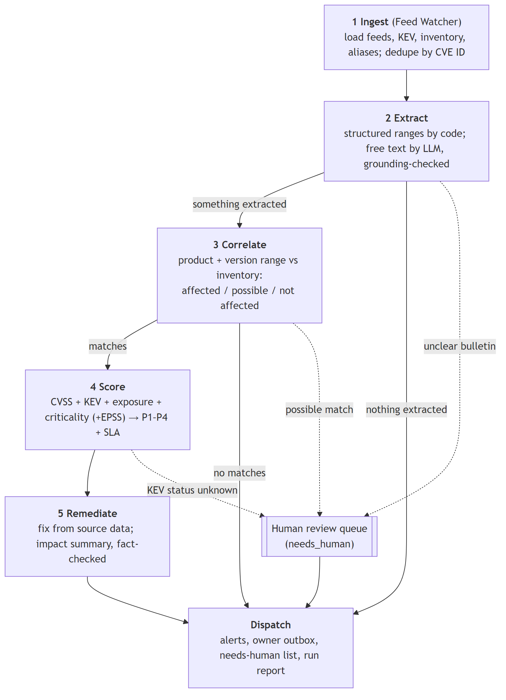

Mermaid source

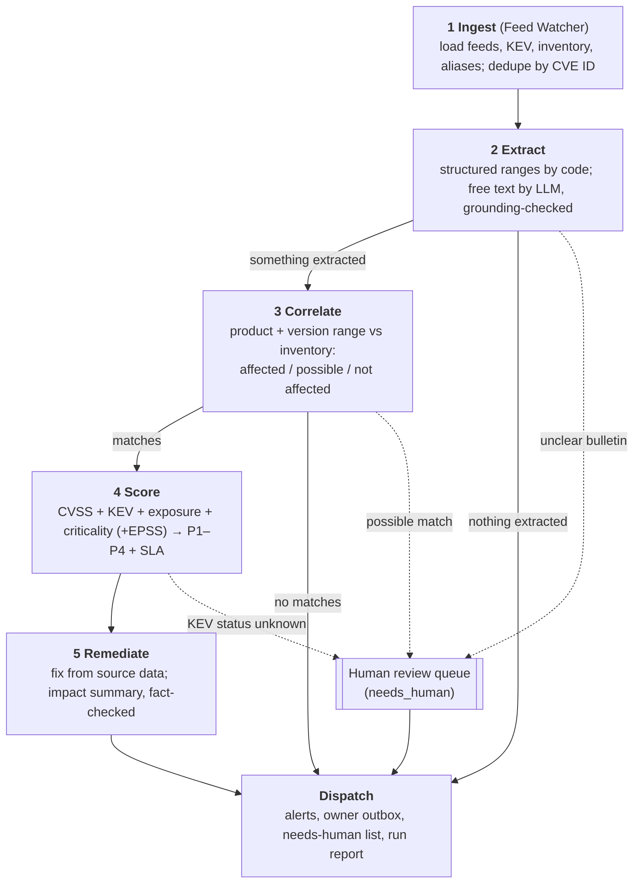

Dotted arrows here show items routed to an analyst; they are not alerted.

| Stage | Supporting modules | What they provide |
|---|---|---|
| 1 Ingest | `sources.py`, `inventory.py` | Fixture, NVD, KEV, OSV and EPSS adapters with checkpoints; inventory contract 1.0 validation |
| 2 Extract | `guards.py`, `llm.py` | Injection detection and grounding checks; `LLMPort` (FakeLLM or audited gateway) |
| 3 Correlate | `versions.py` | PEP 440 ranges, `\|\|` range unions, tolerant parsing |
| 4 Score | `risk_policy.py` | Versioned policy, KEV + internet-facing → P1, EPSS gate |
| 5 Remediate | `guards.py`, `llm.py` | Summary fact checks with template fallback |
| Dispatch | `dispatch.py` | File outputs for the CLI and run trace |
| (LLM calls) | `llm_metering.py`, `artifacts.py` | Encrypted prompts and responses, tokens, cost, budgets |

After the graph finishes, the worker hands the final state to **repositories.py**, which saves everything in one transaction: advisories, inventory snapshot, matches, alerts, review cases, the run summary, audit events and outbox rows.

### 3b. API

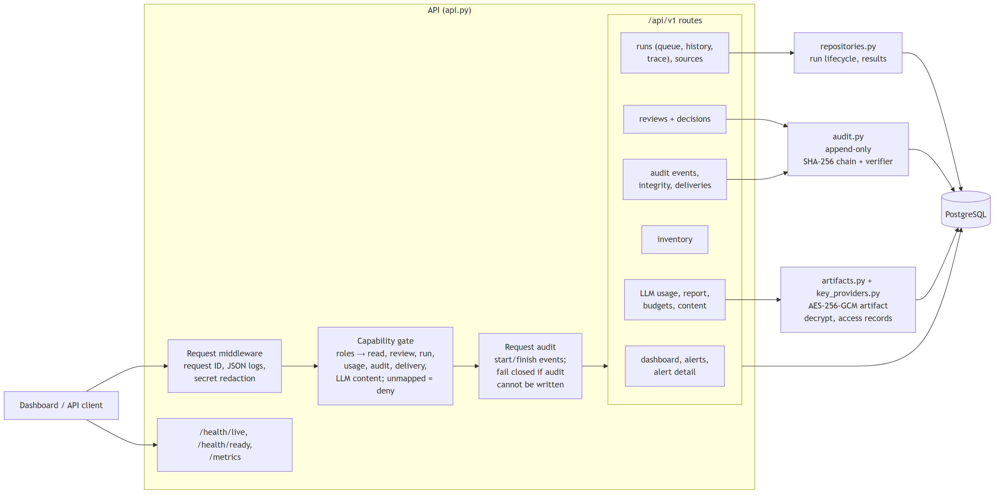

Mermaid source

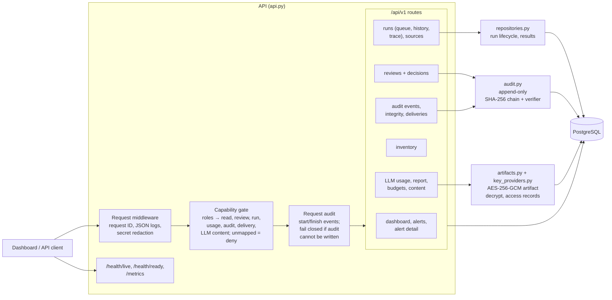

## 4. One scheduled run, end to end

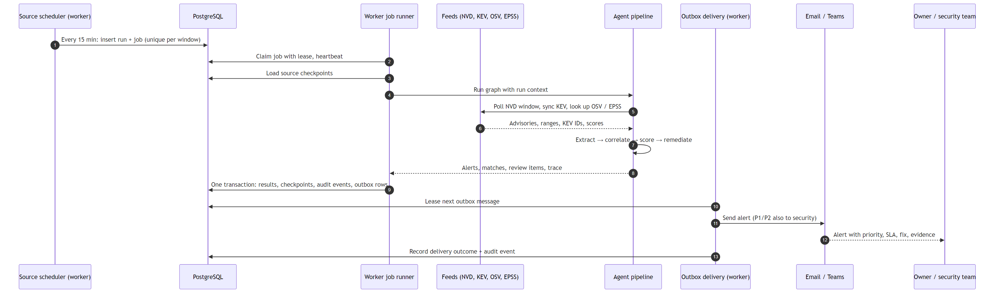

Mermaid source

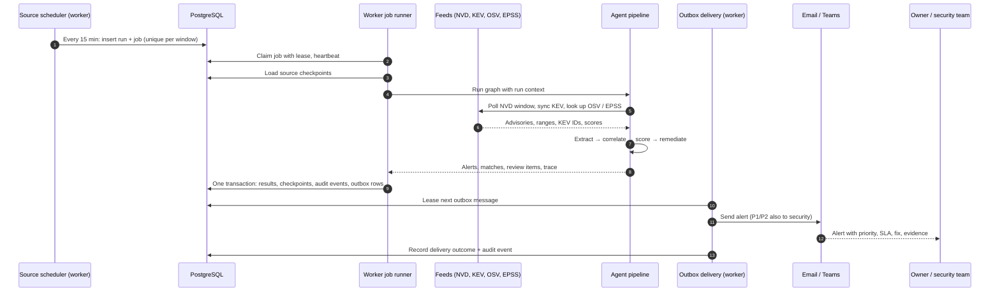

Steps 5 and 11 to 13 only happen when public feeds and outbox delivery are enabled. In the default configuration the pipeline reads the local fixtures and alerts stay in the outbox.

## 5. Manual process vs automated workflow

Orange steps are done by people today. Green steps are done by the agents. Blue is the only step left for an analyst, and only for uncertain matches. The manual lane is an assumption until the security team confirms it; see [PROCESS_IMPROVEMENT_PROPOSAL.md](PROCESS_IMPROVEMENT_PROPOSAL.md) for the baseline still to be collected.

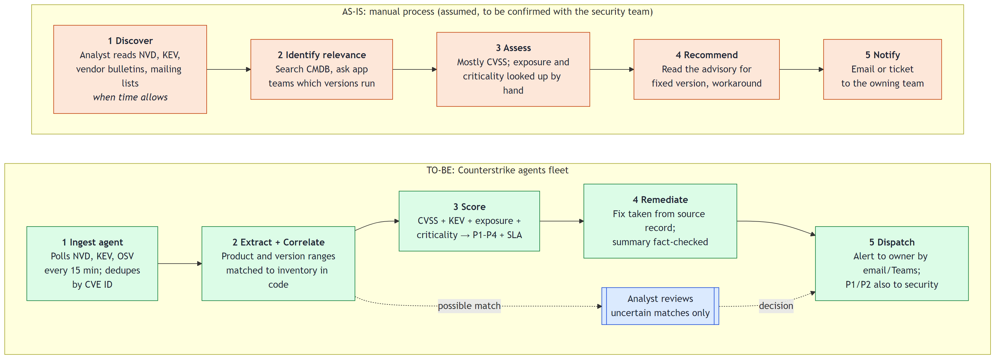

Mermaid source

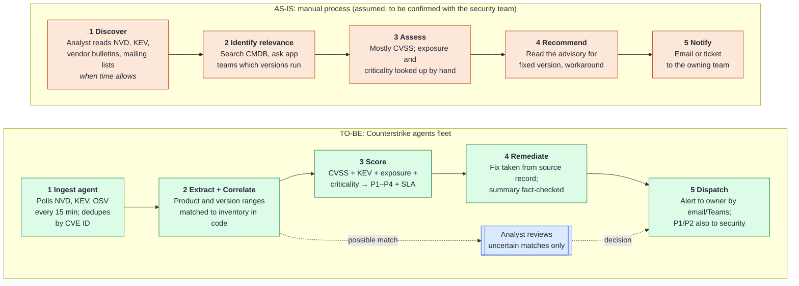

